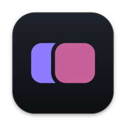
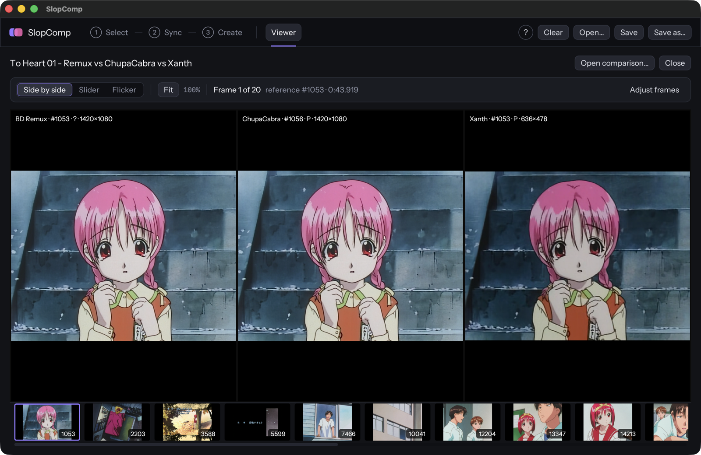
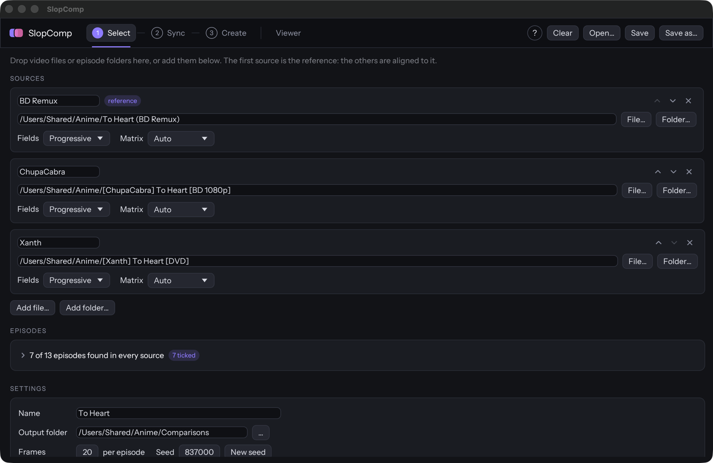
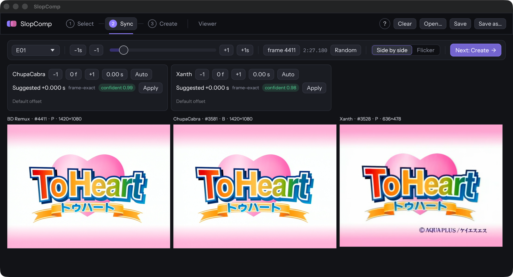
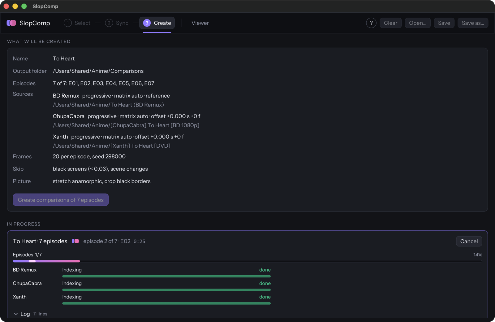

<div align="center">

<h1><br>SlopComp</h1>

**Frame-exact anime source comparisons, without the scripting.**

Line up WEB-DLs, Blu-rays, fansub encodes and DVDs, pick frames automatically,
and get lossless PNG screenshots ready for slow.pics.

[](https://github.com/amq-tutti/slopcomp/releases/latest)
[](LICENSE)

[](https://github.com/amq-tutti/slopcomp/actions/workflows/ci.yml)

[**Download**](#download) · [Features](#features) · [How it works](#how-it-works) · [Command line](#command-line) · [Building](#building-from-source)



</div>

## Features

- **Frame-exact decoding.** Seeking is tested against an independent ffmpeg decode, frame by
  frame, read straight through and in random order, so the frame you ask for is the frame you get.
- **Mixed releases line up.** Sources are aligned by timestamp, so VFR encodes and CFR DVDs match.
  Offsets can be set per source and per episode.
- **Automatic offset suggestions.** Scene cuts are matched between sources, with a confidence
  rating that flags a wrong match.
- **IVTC and deinterlacing** for 1080i BD remuxes and telecined NTSC DVDs.
- **Smart frame picking.** Black screens and scene changes are skipped. Optional rules skip
  near-duplicates, flat or dark frames, or keep only B-frames from an encode.
- **Whole seasons at once.** Drop in episode folders: episodes are paired by their numbers,
  OP/ED chapters can be left out, and you get one comparison per episode.
- **Black borders cropped** per source, and anamorphic DVDs stretched to their display size.
- **Built-in viewer** with side by side, slider and flicker modes, synced zoom and pan, and
  frame-by-frame fixes when a shot isn't right.
- **Shareable output.** Lossless PNGs named for slow.pics batch upload, plus an offline
  `index.html` viewer next to every comparison.
- **Command-line tool** (`comp`) for scripting, with the same projects as the app.

## Download

Get the latest version from the [**Releases page**](https://github.com/amq-tutti/slopcomp/releases/latest).

| Platform | File | Notes |
| --- | --- | --- |
| **macOS** (Apple Silicon, 11+) | `SlopComp-<version>-macos-arm64.dmg` | Not notarized: the first time, right-click the app and choose **Open**. |
| **Linux** (x64, glibc 2.28+) | `SlopComp-<version>-linux-x86_64.AppImage` | `chmod +x` it and run. The `comp` tool alone is in the `.tar.gz`. |
| **Windows** (x64) | `SlopComp-<version>-windows-x64.zip` | Unzip and run `SlopComp.exe`. |

Everything is statically linked (ffmpeg, ffms2, zimg, dav1d), so there's nothing else to install.
`SHA256SUMS.txt` on each release lists the checksums.

## How it works

The app walks you through three steps, then opens the result in the viewer.

### 1 · Select

Drop video files or whole episode folders onto the window. The first source is the reference;
set field handling (progressive, IVTC, deinterlace) and colour matrix per source, pick episodes,
and choose how many frames to take.



### 2 · Sync

Check that the sources line up with live previews, flick between them, and apply the suggested
offsets (or set your own, per episode if a release differs).



### 3 · Create

Review the setup and start. Progress is shown per source and per episode, with a log and a
history of finished jobs.



### Viewer

Look through the result in side by side, slider or flicker mode, zoom in on details, and fix
any shot: move a source a frame either way, jump to an exact frame, or swap the frame for
another. The PNGs, `comp.json` and `index.html` update immediately. From here you can also open
the output folder or slow.pics for upload.

Setups can be saved as TOML projects, which the command-line tool can run too
(`comp project file.toml`), and `slopcomp file.toml` opens one in the app.

<sub>Screenshots show *To Heart* (© AQUAPLUS / KSS) for illustration.</sub>

## Command line

Every download includes the `comp` command-line tool:

- **Windows:** `comp.exe`, next to `SlopComp.exe` in the zip.
- **macOS:** inside the app, at `SlopComp.app/Contents/MacOS/comp`. To run it as `comp` from any
  terminal: `ln -s /Applications/SlopComp.app/Contents/MacOS/comp /usr/local/bin/comp`.
- **Linux:** on its own in `comp-<version>-linux-x86_64.tar.gz`, or through the AppImage:
  `./SlopComp-<version>-linux-x86_64.AppImage comp …`.

```bash
comp info <files…>
comp shot <file> <frame…> -o <dir>              # lossless PNGs of single frames
comp pair -s BD=/bd/folder -s DVD=/dvd/folder   # check episode pairing (no decoding)
comp sync -s BD=/bd/ep01.mkv -s DVD=/dvd/ep01.mkv   # suggest offsets (scene cuts), with confidence
comp run  -s BD=/bd/ep01.mkv -s DVD=/dvd/ep01.mkv -n 20 --seed 1
comp run  -s BD=/bd/folder -s DVD=/dvd/folder   # whole season, one comparison per episode (--episodes 1,2,5 for some)
comp project setup.toml                         # run a saved project (see --save-project)
comp viewer comps/<name>                        # refresh index.html of existing comparisons (no decoding)
comp fix "comps/<name>" --frame 12713 --source DVD --nudge -1   # re-shoot one source's frame
comp fix "comps/<name>" --frame 12713 --replace                 # swap for a random nearby frame
```

Useful `run` options:

- `--offset LABEL=N` / `LABEL=Xs`: frame or time offset. Sources are aligned by timestamp first, so VFR and CFR releases line up.
- `--ivtc LABEL[:tff|bff]` / `--deint LABEL`: field processing for 1080i BD remuxes and NTSC DVDs.
- `--frame-type ENC=B`: only frames that are B-frames in the `ENC` source.
- `--exclude-op-ed`, `--exclude 1:30-3:00`: leave out OP/ED chapters or time ranges. Episodes are compared in full by default.
- `--skip-duplicates`, `--skip-flat`, `--dark 0.1`, `--no-reject`: change the frame-picking rules. By default only black screens and scene changes are skipped.
- `--matrix LABEL=709`, `--no-sar`.
- Black borders (pillarbox/letterbox) are detected per source and cropped from every shot; `--no-crop` keeps them.
- `--open`: open the offline viewer (`index.html`, written next to the PNGs) when done.
- `--open-slowpics`: open the output folder and slow.pics' upload page for a manual drag-and-drop upload. Automated uploads need slow.pics staff permission, so the tool doesn't upload itself.

## Building from source

```bash
deps/build.sh                 # static dav1d, ffmpeg, zimg, ffms2 -> deps/prefix (one-off, ~5 min)
cargo build --release         # builds target/release/comp
```

Requirements: Rust, a C/C++ toolchain, autoconf/automake/libtool, meson, ninja, pkg-config, nasm (x86 only), libclang.
On Windows, build inside MSYS2 UCRT64 (see `.github/workflows/ci.yml`).

Run the app with `cargo run --release -p comp-gui`. See [PLAN.md](PLAN.md) for the architecture and roadmap.

### Testing

```bash
testdata/make_corpus.sh       # synthetic clips (needs system ffmpeg with x264/x265/svt-av1/vpx)
cargo test --release
```

The seek-accuracy test checks every frame of every clip, read straight through and in random
order, against the MD5s from an independent system ffmpeg decode.

### Packaging

```bash
packaging/macos/bundle.sh --dmg      # macOS: "target/release/SlopComp.app" + .dmg
packaging/linux/docker-build.sh      # Linux AppImage + CLI tarball in manylinux_2_28 (Docker) → target/linux/
packaging/windows/package.sh         # Windows (MSYS2 UCRT64): zip, fails on non-system DLL imports
packaging/notices.sh                 # regenerate THIRD_PARTY_NOTICES.md
```

### Releasing

Note each user-visible change under **Unreleased** in [CHANGELOG.md](CHANGELOG.md) as you go. To release:

```bash
packaging/release.sh 0.2.0
```

It moves the Unreleased notes under the new version, sets the version in `Cargo.toml`, shows the notes and asks before it commits, tags `v0.2.0` and pushes. The tag runs `.github/workflows/release.yml`: all three platforms are built and a **draft** GitHub release is created with the changelog notes, the downloads and SHA256SUMS. Check it on the repo's Releases page and publish it. Versions with a suffix (`0.2.0-beta.1`) are marked as pre-releases.

The workflow can also be started from the Actions tab without a tag, to test the builds; that run doesn't create a release. macOS builds are ad-hoc signed unless the Developer ID secrets listed in the workflow are set.

## License

SlopComp is free software under the [GNU GPL v3.0 or later](LICENSE). It bundles ffmpeg, ffms2,
zimg, dav1d and other libraries; their licences are listed in
[THIRD_PARTY_NOTICES.md](THIRD_PARTY_NOTICES.md).
